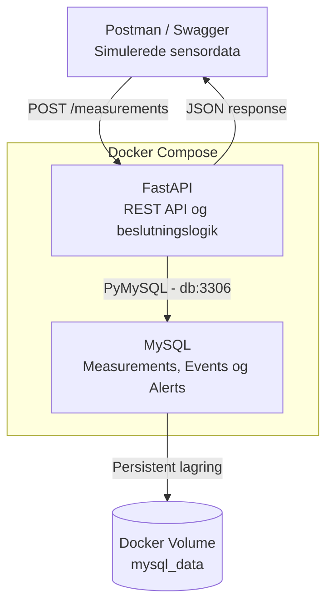

# Arkitekturdokumentation
## Intelligent IoT – Monitoring MVP

### 1. Formål

MVP'en demonstrerer en del af Managed Services-domænet
hos Intelligent IoT Solutions A/S.

Systemet modtager simulerede temperaturmålinger,
registrerer domæne-events og opretter alarmer,
når en fastsat grænseværdi overskrides.

### 2. Systemkomponenter

**FastAPI (Python)**
- Eksponerer REST API-endpoints
- Modtager og validerer sensordata
- Udfører beslutningslogik
- Registrerer events og alarmer

**MySQL**
- Gemmer temperaturmålinger
- Gemmer registrerede domæne-events
- Gemmer alarmer

**Docker Compose**
- Administrerer API- og databasecontaineren
- Etablerer netværksforbindelsen mellem dem
- Bruger Docker Volume til persistent datalagring

### 3. Event og beslutningslogik

Når POST /measurements modtager en måling:

1. SensorValueReceived registreres.
2. Målingen sammenlignes med grænseværdien 80 °C.
3. Ved temperatur over 80 °C registreres
   AnomalyDetected.
4. Ved en afvigelse oprettes en alarm.
5. Måling, events og eventuel alarm gemmes i MySQL.

### 4. Relation til Domain-Driven Design

Løsningen tager udgangspunkt i Managed Services
og den forretningsmæssige aktivitet med at
overvåge IoT-enheder.

SensorValueReceived og AnomalyDetected repræsenterer
hændelser, som er relevante for dette domæne.

I denne MVP registreres events i en databasetabel.
Der er endnu ikke implementeret en selvstændig
event broker eller asynkron event-distribution.

### 5. Arkitektoniske afgrænsninger

MVP'en anvender en samlet FastAPI-applikation.

Databaseforbindelsen er placeret separat i
database_mysql.py, men løsningen er ikke en fuld
Ports & Adapters-implementering.

Temperaturmålingerne simuleres via Swagger eller
Postman. Der er ikke tilkoblet en fysisk IoT-sensor.

API'et har endnu ikke brugerautentifikation og
er beregnet til lokal demonstration.

### 6. Systemarkitektur – diagram

