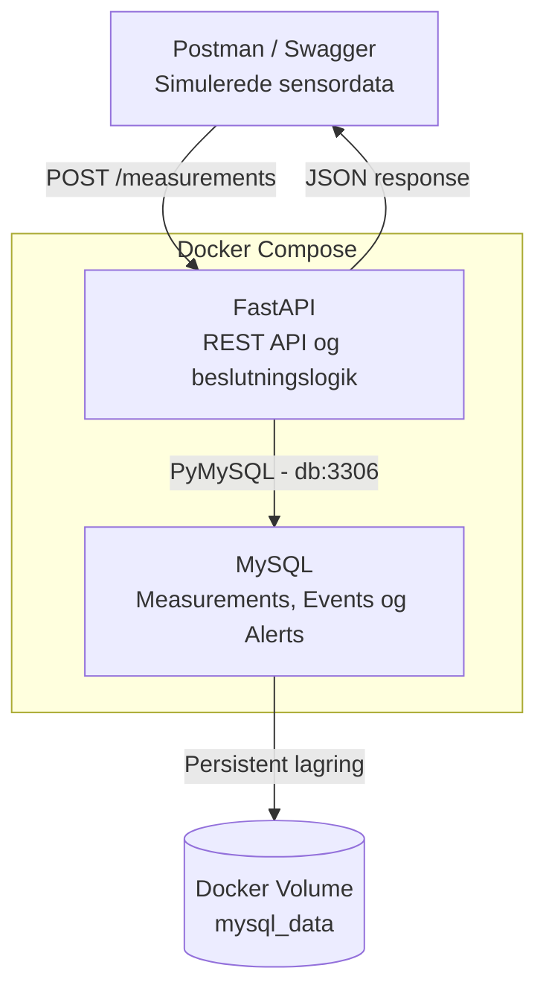

# Arkitekturdokumentation
## Intelligent IoT – Monitoring MVP

### 1. Formål

MVP'en demonstrerer en del af Managed Services-domænet
hos Intelligent IoT Solutions A/S.

Systemet modtager simulerede temperaturmålinger,
registrerer domæne-events og opretter alarmer,
når en fastsat grænseværdi overskrides.

### 2. Systemkomponenter

**FastAPI (Python)**
- Eksponerer REST API-endpoints
- Modtager og validerer sensordata
- Udfører beslutningslogik
- Registrerer events og alarmer

**MySQL**
- Gemmer temperaturmålinger
- Gemmer registrerede domæne-events
- Gemmer alarmer

**Docker Compose**
- Administrerer API- og databasecontaineren
- Etablerer netværksforbindelsen mellem dem
- Bruger Docker Volume til persistent datalagring

### 3. Event og beslutningslogik

Når POST /measurements modtager en måling:

1. SensorValueReceived registreres.
2. Målingen sammenlignes med grænseværdien 80 °C.
3. Ved temperatur over 80 °C registreres
   AnomalyDetected.
4. Ved en afvigelse oprettes en alarm.
5. Måling, events og eventuel alarm gemmes i MySQL.

### 4. Relation til Domain-Driven Design

MVP'en tager udgangspunkt i virksomhedens Managed
Services-forretning og det identificerede core
subdomain Monitoring & Analytics fra delopgave 1.

Domænet understøtter capability'en Monitoring &
Analytics Management og værdistrømmen Deliver
Managed Monitoring Service.

Systemet demonstrerer en afgrænset del af
overvågningsprocessen, hvor sensordata modtages,
behandles og vurderes mod en grænseværdi.

Ved modtagelse af en måling registreres eventet
SensorValueReceived.

Hvis temperaturen overstiger 80 °C, registreres
AnomalyDetected, og systemet opretter en alarm.

Alarmen repræsenterer en potentiel driftsafvigelse,
ikke en bekræftet fejl eller et automatisk
servicebehov.

I delopgave 1 skelnes mellem måling,
driftsafvigelse og servicebehov. MVP'en
implementerer de første trin, men ikke den
efterfølgende faglige vurdering eller overdragelse
til Service Management.

Domæne-events gemmes i MySQL. Der er endnu ikke
implementeret en message broker eller asynkron
event-distribution.

Løsningen er derfor en teknisk afgrænsning af
den arkitektur, der blev foreslået i delopgave 1.

### 5. Arkitektoniske afgrænsninger

MVP'en anvender en samlet FastAPI-applikation.

Databaseforbindelsen er placeret separat i
database_mysql.py, men løsningen er ikke en fuld
Ports & Adapters-implementering.

Temperaturmålingerne simuleres via Swagger eller
Postman. Der er ikke tilkoblet en fysisk IoT-sensor.

API'et har endnu ikke brugerautentifikation og
er beregnet til lokal demonstration.

### 6. Systemarkitektur – diagram

